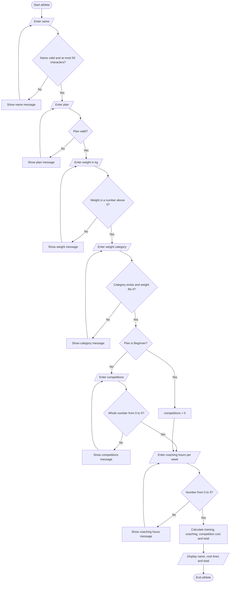

# Algorithm Design: ATA Martial Arts Fee Calculator

## 1. IPO Table

| Inputs | Processes | Outputs |
|--------|-----------|---------|
| Name | Validate each input (re-ask until valid) | Athlete name |
| Plan | Calculate training cost | Training cost |
| Weight (kg) | Calculate coaching cost | Coaching cost |
| Weight category | Calculate competition cost | Competition cost |
| Competitions this month | Calculate monthly total | Monthly total |
| Coaching hours per week | | |

All money outputs are shown in pounds to 2 decimal places.

## 2. Pseudocode

```
CONSTANT WEEKS = 4, COACH_RATE = 9.50, COMP_FEE = 22.00, MAX_COACH_HRS = 5
CONSTANT MAX_COMPETITIONS = 5, MAX_NAME_LENGTH = 50
CONSTANT WEEKLY_FEE = {Beginner:25, Intermediate:30, Elite:35}
CONSTANT CATEGORIES = [(Flyweight,66), (Lightweight,73),
    (Light-Middleweight,81), (Middleweight,90), (Light-Heavyweight,100),
    (Heavyweight, no limit)]

REPEAT   // one pass per athlete
  name <- INPUT until non-empty, at most 50 characters,
          letters/spaces/hyphens/apostrophes only
  plan <- INPUT until plan is in WEEKLY_FEE
  weight <- INPUT until number > 0
  category <- INPUT until category exists AND weight fits that category
  IF plan = Beginner THEN competitions <- 0
  ELSE competitions <- INPUT until whole number between 0 and MAX_COMPETITIONS
  coachHours <- INPUT until number between 0 and MAX_COACH_HRS  // per week
  training <- WEEKLY_FEE[plan] * WEEKS
  coaching <- coachHours * COACH_RATE * WEEKS
  comps <- competitions * COMP_FEE
  total <- training + coaching + comps
  DISPLAY name, each cost line, total   // 2 d.p.
UNTIL user chooses to stop
```

## 3. Flowchart (one athlete)



## 4. Test Cases

| Input | Expected result | Reason |
|-------|-----------------|--------|
| Intermediate, 1 competition, 2 coaching hrs/week | 218.00 | 120.00 training + 76.00 coaching + 22.00 competition |
| Elite, 3 coaching hrs/week, 0 competitions | 254.00 | 140.00 training + 114.00 coaching |
| Coaching hours = 5 | Accepted | 5 is the maximum allowed (boundary) |
| Coaching hours = 5.5 | Rejected, ask again | Above the 5 hour maximum |
| Coaching hours = 6 | Rejected, ask again | Above the 5 hour maximum |
| Beginner with 1 competition | Rejected | Only Intermediate and Elite may enter competitions |
| 81 kg in Light-Middleweight | Accepted | 81 is exactly the upper limit (boundary) |
| 81.5 kg in Light-Middleweight | Rejected, ask again | Above the 81 kg limit for this category |
| Weight "abc" | Rejected, ask again | Not a number |
| Empty name | Rejected, ask again | Name must not be empty |
| 99999 competitions (Elite) | Rejected, ask again | Above the maximum of 5 competitions |
| Name of 51 characters | Rejected, ask again | Above the maximum of 50 characters |

## Assumptions

1. Coaching hours are entered per week and multiplied by 4 to get the monthly
   coaching cost.
2. A month is exactly 4 weeks.
3. MAX_COMPETITIONS = 5 and MAX_NAME_LENGTH = 50 are sanity limits chosen by
   the developer, not client rules; the client should confirm them.
